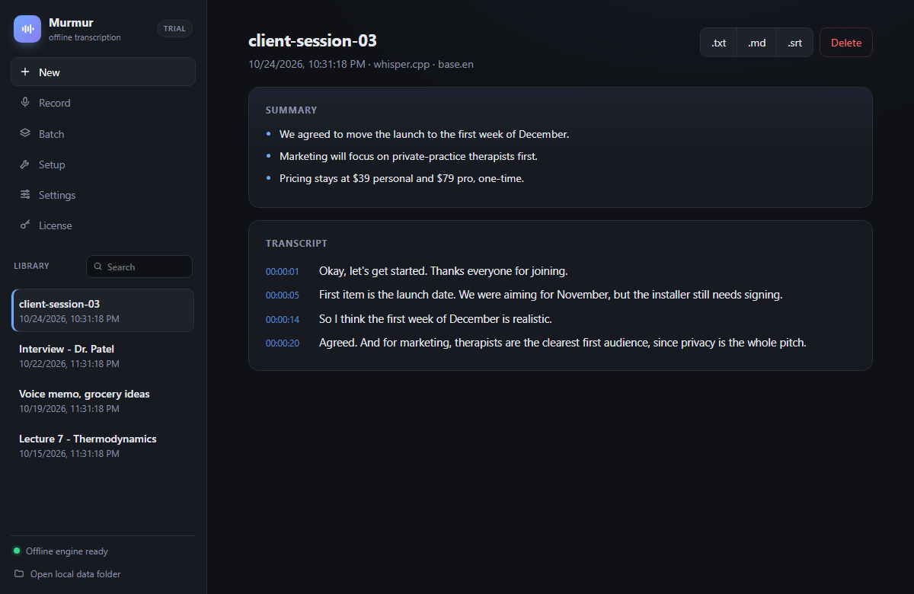

<div align="center">

# Murmur

**Private, offline transcription and summaries for Windows.**

Transcribe audio and video files or live mic recordings, get an automatic summary and a
searchable local library, and export to txt, md or srt. Everything runs on your device.
Your audio never leaves your machine.

[Website](https://hbrimer.github.io/murmur/) ·
[Features](#features) ·
[Quick start](#quick-start) ·
[Architecture](#architecture) ·
[Privacy](#privacy)




</div>

## Features

| | |
|---|---|
| **Import** | Drag and drop or pick audio/video (mp3, m4a, wav, mp4, mov, mkv, …) |
| **Record** | Capture straight from the microphone and transcribe |
| **Batch** | Queue many files or a whole folder |
| **Summaries** | On-device extractive summarizer (TextRank, zero dependencies) |
| **Library** | Searchable, stored locally, delete any time |
| **Export** | txt, md and srt |
| **Settings** | Model, language, translate to English, summary length |
| **Licensing** | Offline key verification with a fully functional trial |
| **Setup** | Detects the engine and can download a model on request |

Until the engine and a model are installed, the app sends you to **Setup** with a clear message.

## Quick start

**Requirements:** [Node.js](https://nodejs.org/) 18 or newer.

```bash
git clone https://github.com/HBrimer/murmur.git
cd murmur
npm install
npm start
```

### Enable offline transcription

Murmur is built on [whisper.cpp](https://github.com/ggerganov/whisper.cpp). The binaries are
large, so they are not in the repository:

1. Download a whisper.cpp release and put `whisper-cli.exe` **plus its DLLs** in `bin/`
   (macOS/Linux: `bin/whisper-cli`). The older names `whisper` and `main` are also detected.
2. In the app, open **Setup** and download a model. Downloads go to the user-data
   `models/` folder. Bundled `ggml-*.bin` files in the app's `models/` folder also work.
3. Recommended: put an **ffmpeg** binary in `bin/` or install it on your PATH, so files
   other than WAV work.
4. Restart the app. The sidebar status turns green ("Offline engine ready").

Everything is detected automatically. No code changes are needed.

## Development

```bash
npm start        # run the app
npm test         # run the unit tests (node:test, no extra dependencies)
npm run dist     # build installers (NSIS / dmg / AppImage) into dist/
```

Ship the whisper and ffmpeg binaries and any default model through `extraResources`
(configured in `package.json`) or your release pipeline.

> **Windows tips:** `npm run dist` needs Developer Mode turned on (electron-builder
> creates symlinks). If you launch the built `Murmur.exe` from a VS Code terminal, clear
> `ELECTRON_RUN_AS_NODE` first, or it exits without opening a window.

## Architecture

```
src/
  main.js        Electron main process: local I/O, IPC, job orchestration
  preload.js     Locked-down contextBridge, the only surface the UI can call
  transcribe.js  ffmpeg -> whisper.cpp pipeline with cancel, progress and clear errors
  ffmpeg.js      Any media -> 16 kHz mono WAV (bundled or system ffmpeg)
  engine.js      Finds the binary and models; optional model download
  library.js     Transcript store with atomic writes and index recovery
  summarize.js   On-device extractive summarizer, no dependencies
  settings.js    Persisted settings (userData/settings.json)
  license.js     Offline Ed25519 license verification
  renderer/      UI: New, Record, Batch, Setup, Settings, License
scripts/
  licensing.js   Seller-side keygen and key-signing CLI
test/            Unit tests (npm test)
docs/            Website, served by GitHub Pages
```

## Privacy

- The transcription pipeline makes **no network calls**. Audio stays on disk.
- The **only** code that uses the network is the optional model download in Setup
  (Hugging Face), and it runs only when you click Download.
- All data lives in the OS user-data folder. **Open local data folder** in the sidebar shows it.
- License keys are verified offline. There is no account and no license server.

> Before launch we will run the built app behind a network monitor to confirm zero
> outbound traffic during transcription.

## Licensing (for the seller)

```bash
node scripts/licensing.js keygen
# writes secrets/license_private.pem and prints the public key;
# paste the public key into PUBLIC_KEY_PEM in src/license.js

node scripts/licensing.js sign --name "Jane Doe" --email jane@x.com --tier pro --days 0
# prints a license key for the buyer (--days 0 = never expires; --tier personal|pro)
```

Connect `sign` to your storefront's post-purchase webhook (Gumroad, Lemon Squeezy or
Paddle) to issue keys automatically. `secrets/` is gitignored. Never commit it.

## Pricing

| Personal | Pro |
|---|---|
| **$39 one-time** | **$79 one-time** |
| The full app and every export format | Everything in Personal, plus batch processing and larger models |

The offline core stays subscription-free.

<details>
<summary><strong>Business notes</strong></summary>

### Why this sells

Paid apps in this space (MacWhisper, Superwhisper) already prove people pay. Murmur's
opening wedge:

- **Windows is underserved.** The popular paid apps are Mac-first.
- **Privacy is the product.** Therapists, lawyers, doctors, journalists and executives
  can't send audio to a cloud service. "100% on-device" is a moat free web tools can't cross.
- **Own-it pricing.** A one-time purchase in a market full of subscriptions.

### Go-to-market

Niche first: pick one audience (for example private-practice therapists), speak to their
privacy and compliance needs directly, sell through their communities, then expand.

### Before launch

- Decide which model size(s) to ship (accuracy vs. size and speed).
- Code-sign the installers (Windows SmartScreen). This needs a certificate.
- Set up a storefront and connect the licensing webhook.
- Run the network audit described under [Privacy](#privacy).

See [LAUNCH_PLAN.md](LAUNCH_PLAN.md) for the full checklist and
[COLLABORATING.md](COLLABORATING.md) for how the team works.

</details>

---

© Harrison Brimer. All rights reserved.
